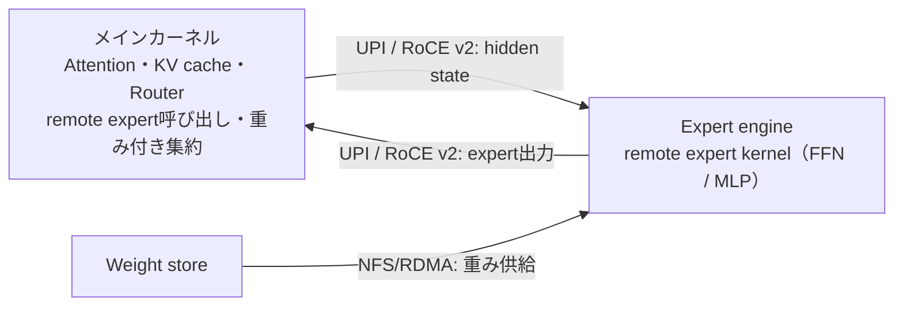

# Expert Fabric

UPIまたはRoCE v2経由でMoE expertを呼び出す、Linux x86-64向けのC++20実行エンジン。

**状態**　CPUとHIPのFP32 SwiGLU expert、世代管理、複数実行先への配置、Prometheus exporter、n-gram候補キャッシュを実装済み。Transformer本体とDSparkの実行は今後の対象。

## 動かす

C++20対応コンパイラ、GNU Make、Python 3、libyamlの開発パッケージを使う。

```sh
make test
printf '%s\n' ENGINES 'AUTOLOAD ffn 1 examples/tiny.efmlp' \
  '@cpu-experts PUBLISH ffn 1 -' '@cpu-experts INVOKE ffn 1 2' QUIT |
  build/expert-fabric --config configs/local-cpu.yml
```

`ENGINES`にYAMLの実行先ごとの種別、通信経路、重みの容量上限と空き、設定された帯域が出る。`AUTOLOAD`は帯域の大きい順に試し、重みの容量が不足した場合は次の実行先を試す。同率ならYAML順。`@実行先ID`を付けると特定の実行先を選べる。世代の切り替えは`PUBLISH ffn 新世代 旧世代`、排出した世代の解放は`RETIRE ffn 旧世代`で行う。

重みファイルの先頭は `EFMLP1 入力幅 中間幅`。続けてgate、up、downの順でrow-majorのFP32値を書く。CPUではRAMに、HIPではVRAMにロード後の重みを保持する。NFS/RDMAの既存マウント上にファイルを置く構成も同じ`LOAD`を使う。

### HIPとRoCE v2

```sh
make BUILD_DIR=build/hip HIP=1 HIP_ARCHS='gfx906 gfx1030 gfx1100' test
make BUILD_DIR=build/rdma RDMA=1
```

HIP実行先は`target_kind: gpu`と`gpu_device: 0`のように指定する。HIPビルドの`test`はデバイス0で実行する。RoCE v2ビルドにはlibibverbsとlibrdmacmの開発パッケージが必要。隔離された検証ネットワーク上でworkerを `--serve-rdma ADDRESS --weights-root DIR` 付きで起動する。workerのYAMLにはローカル実行先を一つ、メインのYAMLには`transport: roce_v2`と`endpoint: "ADDRESS"`を指定する。経路が別のインターフェースのIPを送信元に選ぶ場合は、`source_address`にローカルのRoCE用IPを指定する。リモートの`LOAD`パスはworkerの重みディレクトリが基準。要求と応答は各1 MiBまでで、接続は逐次処理する。

`transport: upi`では`main.numa_node`と実行先の`numa_node`を異なるIntel UPIソケットに指定する。メインとworkerをそれぞれのCPUに固定し、workerのメモリを指定ノードから確保する。

`speculation.ngram.enabled: true`で確定済みtoken列を`NGRAM_OBSERVE モデル トークナイザ 共有スコープ token...`から登録できる。同じ区画の`NGRAM_PROPOSE`は文脈末尾に一致する続きを候補として返す。`cache.max_ram_mib`はトークン、キーとエントリ固定費の論理上限。

## 目指すもの

Transformer側から独立してexpertの演算資源と重みの格納容量を増やせる構成を目指す。この設計でexpertが担当するのはFFN／MLP部分。attention、KV cache、ルーティング、expert出力の重み付き集約はTransformer側に置く。呼び出し側は物理配置を意識せず、expertの識別子と世代を指定して、ルーティング済みのhidden stateを送る。



- 重みの供給：NFS/RDMAを使う。
- 実行データの配送：hidden stateと結果のための専用プロトコルを検討する。
- ライフサイクル：ロード、公開、実行、旧世代の排出と解放を定義する。
- expertの配置と入れ替え：メイン側がYAML設定を持ち、remote engineが通知するCPU／GPUごとの容量と帯域を使って配置し、入れ替えを指示する。
- [通信経路の指定](docs/architecture.md#通信経路)：接続先ごとに`upi`または`roce_v2`を選ぶ。DSparkの候補生成は別NUMAノードに配置し、UPI経由で呼び出す構成を基準にする。

NFS/RDMAによるファイルアクセスと、アクセラレータの実行用メモリへの配置は別の工程。ストレージから演算器までの直接転送や性能は、現時点では仮定しない。

## 文書

- [アーキテクチャ](docs/architecture.md)
- [プロトコル草案](docs/protocol.md)
- [最小PoCと検証項目](docs/poc.md)
- [処理時間プロファイリング](docs/profiling.md)

## 実装言語

実行エンジンはC++20、GPUの演算はHIPで実装する。x86-64のCPUでは`cpu_vectorize: true`でAVX2を使用できる。非対応CPUにはscalar経路を使う。

## 対応対象と基準機材

- ホストはLinux x86-64を対象とする。
- RDMAはRoCE v2を使い、ConnectX-4 Lxの25GbEモデルを検証基準とする。配送はLinuxの標準verbsとRDMA CMを基準にし、ConnectX固有機能は必須にしない。
- GPUはAMD Instinct MI50（`gfx906`）からRadeon RX 7900 XTX（`gfx1100`）までの世代を検討対象とする。まず両端の2機種でHIPバックエンドを検証し、対応機種とROCmの組み合わせは実機で確認する。[AMDのLinux対応表](https://rocm.docs.amd.com/projects/install-on-linux/en/docs-7.2.0/reference/system-requirements.html)
- GPUへの重みロードは、まずNFS/RDMAでホストRAMに読み、HIPでVRAMへ転送する。NICからVRAMへ直接配置する経路は、対応を実機で確認できた組み合わせで検証する。

NFS/RDMAからVRAMへ直接読めるかは `examples/hipfile_nfs_probe.cpp` で確認できる。hipFileが入ったROCmのパスを指定し、RDMAでマウントしたNFS上の4 KiB以上のファイルを渡す。プローブはマウントの `proto=rdma` を確認し、POSIX互換モードを無効にして先頭4 KiBをGPUメモリに読む。expertの `LOAD` への接続は別途必要。[AMDのNFSoRDMA設定](https://rocm.docs.amd.com/projects/hipFile/en/develop/how-to/setup-nfsordma.html)

```sh
rocm=/path/to/rocm-with-hipfile
g++ -std=c++20 -D__HIP_PLATFORM_AMD__ -isystem "$rocm/include" \
    examples/hipfile_nfs_probe.cpp -L"$rocm/lib" -Wl,-rpath,"$rocm/lib" \
    -lamdhip64 -lhipfile -o /tmp/hipfile-nfs-probe
HIPFILE_ALLOW_COMPAT_MODE=false HIPFILE_UNSUPPORTED_FILE_SYSTEMS=true \
    /tmp/hipfile-nfs-probe /mnt/nfs/weights.bin
```

## 未決定

GPUごとの検証環境、演算形式、wire format、RDMA操作の選択、ライセンスは未決定。

## 参考仕様

- [RFC 8166: RPC-over-RDMA](https://www.rfc-editor.org/info/rfc8166/)
- [RFC 8267: NFS on RPC-over-RDMA](https://www.rfc-editor.org/info/rfc8267/)

これらは既存の重み供給経路の参考仕様であり、このrepoのexpert実行プロトコルは独自の設計草案。
