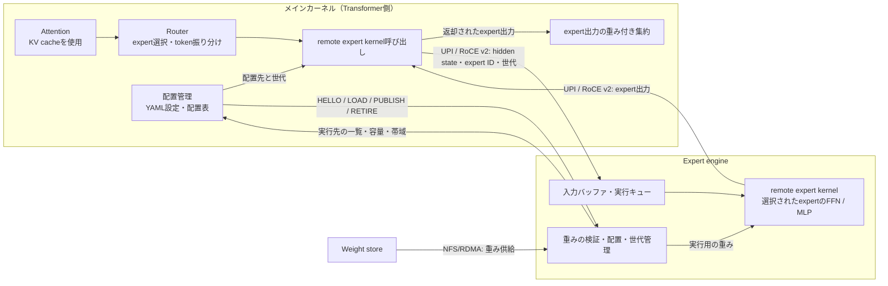
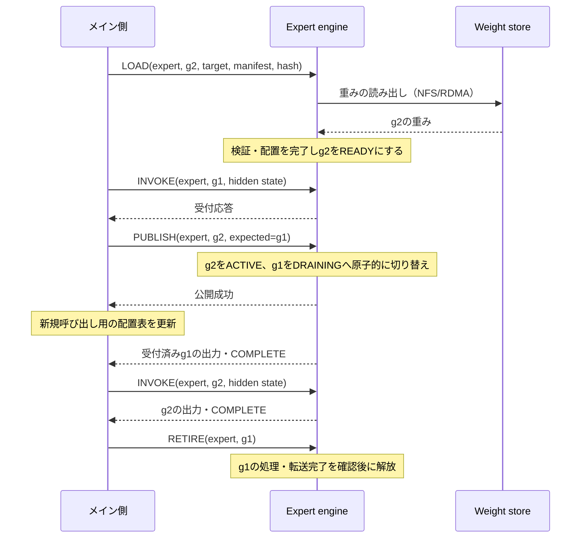

# アーキテクチャ草案

この設計では通常のMoE TransformerのFFN／MLP部分をexpertとして外部化する。attentionとKV cacheはTransformer側に置き、expert内部ではattentionを実行しない。



図はattentionとMoE部分の責務と通信境界を示す。正規化、残差接続、共有expertなどのモデル固有の経路は省略している。expertの選択と集約用のrouting weightの保持はTransformer側が担い、engineは指定されたexpertのMLP出力を返す。

## カーネルの構成

メインカーネルとremote expert kernelは個別の実装単位にする。メインカーネルはMoE処理の一部としてremote expert kernelを呼び出す経路を内包する。remote expert kernelはExpert engineから単独で実行できるようにし、指定された世代の重みとhidden stateを受け取ってFFN／MLP出力を返す。最初のCPU PoCでもこの境界を設け、同一プロセス内の呼び出しで流れを検証してからRoCEの経路を追加する。

ここでの内包はメイン側の実行フロー上の関係を指す。HIP上のカーネル起動や融合の方式は実装時に決める。

## DSpark対応案

DeepSeekのDSparkを使う場合は、候補token列を生成するDSpark用drafterと、FFN／MLPを実行するremote expert kernelを別にする。メイン側はconfidenceに応じて検証するprefix長を決め、ターゲットモデルで検証し、採択結果とKV cacheを管理する。[DSpark論文](https://arxiv.org/abs/2607.05147)

ターゲットモデルの各MoE層では、検証対象のtokenを通常どおりルーティングし、宛先ごとにhidden stateをまとめてremote expertへ送る。同じexpertに集まったtokenはまとめてFFN／MLPを実行する。expert kernelは通常decodeと検証の両方で使い、expert ID・世代と可変のtoken数を受け取る。

DSpark drafterはメイン側と同じホストの別ソケットに属するNUMAノードで動かす。メイン側からUPI経由で必要なターゲット側の特徴量と要求を渡し、drafterは候補tokenとconfidenceを返す。draftモデルの重みと実行状態はdrafter側に保持する。検証時のremote expert呼び出しには、そのengineに設定された通信経路を使う。

## メイン側の高速化

- **HIPストリーム**。初期構成では計算用と転送用の2本を試す。事前確保したバッファを交互に使い、独立した処理のコピーと演算を重ねる。依存点はHIPイベントでつなぐ。同じ要求のexpert出力に依存する演算は応答後に実行する。continuous batchingは初期構成の前提から外し、まず1本と2本を同じ負荷で比較する。[HIPの非同期実行](https://rocm.docs.amd.com/projects/HIP/en/docs-7.2.0/how-to/hip_runtime_api/asynchronous.html)
- **GPUルーティング**。GPUでtop-k、宛先ごとの送信用パック、expert出力の重み付き集約を行う。CPUはUPI／RoCE v2の配送と完了処理を担当する。
- **検証量の調整**。DSparkのconfidenceと直近のCPU expertキュー待ちを使って、検証する候補列の長さを決める。検証対象は可変長のまま詰め、採択した分だけターゲットモデルのKVを確定する。
- **attentionとKV**。prefillとdecodeの実行経路を分け、長いコンテキストはページ単位のKV管理を検討する。attentionのカーネルは対象モデルとGPU世代に合わせて選ぶ。
- **カーネル融合とHIP Graph**。残差加算とRMSNormなど隣接した処理を融合する。HIP Graphは対応環境で使い、expert応答待ちを挟まない固定区間をキャプチャする。

[Strataから取り込む高速化](strata-optimizations.md)に、CPU expertのNUMA配置、GPU側の待ち合わせ、n-gramの採算判定、長文prefillの分割を記載する。

## 長いコンテキストでのDSpark退避

DSparkの重みはworker側のローカルSSDに置き、起動または再開時にロードする。稼働中の重みはGPUメモリに置き、decodeの各ラウンドでSSD読み出しを待たない。コンテキスト長がYAMLのしきい値に達した要求はDSparkを休止し、進行中の処理が終わってからその要求のdraft KVを解放する。workerでDSparkを使う要求がなくなれば、設定に応じて重みもGPUメモリから解放する。再開はSSDからの重みロードと、正しいコンテキストからのdraft状態の再構成が完了してから行う。その間もターゲット側はdecodeを続ける。

**n-gram先読み**はDSpark休止中にも使える。確定済みの入力・出力token列から現在の末尾と一致するn-gramを探し、その続きを短い候補列としてターゲットモデルで検証する。候補がなければ通常decodeを続ける。最初はgreedy decodeで通常経路と同じtoken列になることを確認する。[vLLMのn-gram先読み](https://docs.vllm.ai/en/latest/features/speculative_decoding/n_gram/)

**n-gram候補のRAMキャッシュ**は任意で有効にする。直近に完了したリクエストの確定tokenから、末尾の数token IDをキーに、その後に観測した短いtoken列を索引に残す。次のリクエストでは同じ末尾をキーに候補を引き、長文の全履歴を毎token走査する費用を避ける。上限はYAMLの`max_ram_mib`で指定し、古いリクエスト由来の候補から退避する。候補の共有は同じモデル・tokenizer・明示的な共有範囲に限る。ヒット時も現在の文脈を使ってターゲットモデルで検証する。[llama.cppのn-gramキャッシュ](https://github.com/ggml-org/llama.cpp/blob/master/docs/speculative.md#n-gram-cache-ngram-cache) · [vLLMのsuffix decoding](https://docs.vllm.ai/en/latest/features/speculative_decoding/suffix/)

## 通信経路

メイン側のYAMLでDSpark drafterとexpert engineの接続先ごとに`transport`を指定する。

```yaml
dspark:
  transport: upi
  numa_node: 1

expert_engines:
  - id: expert-01
    transport: roce_v2
    endpoint: "192.0.2.10:7400"
```

- `upi`は、同一Linuxホスト内のIntel UPI経由でつながる別ソケット上のNUMAノードを指定する。実行スレッドを対象ノードに割り付け、NUMA配置した共有メモリに要求と応答を置く。メイン側と実行先のソケットを起動時に検証する。同じソケット内にも複数のNUMAノードがあり得るため、NUMAノード番号が異なることだけでは判定しない。[IntelのUPI解説](https://www.intel.com/content/www/us/en/developer/articles/technical/xeon-processor-scalable-family-technical-overview.html) · [LinuxのNUMAメモリポリシー](https://docs.kernel.org/admin-guide/mm/numa_memory_policy.html)
- `roce_v2`は、RoCE v2で接続できるアドレスを指定し、RDMAで要求と応答を配送する。

指定した経路が使えない場合は、接続エラーをメイン側に返す。重みの供給には別経路のNFS/RDMAを使う。

[CPU expertとDSparkの比較用YAML](../configs/cpu-expert-dspark.example.yml)では、メインとCPU expertの配置を共通設定に置き、`active_profile`でDSparkの無効化、メイン側GPU、別ソケットのGPUを切り替える。`local`は比較用にメインと同じプロセス内でdrafterを呼ぶ指定。DSparkの各プロファイルは設計案。現在の実行エンジンには [ローカルCPU用YAML](../configs/local-cpu.yml) を使える。

## 責務

| 要素 | 責務 |
| --- | --- |
| Weight store | 不変の重みファイルとmanifestを供給する |
| Expert engine | 重みの検証・配置、expertのFFN／MLP実行、バッファ管理、世代管理 |
| Transformer側：attention | attentionの実行とKV cacheの管理 |
| Transformer側：router・集約 | tokenのルーティング、世代の選択、結果の対応付けと重み付き集約 |
| メイン側の配置管理 | YAML設定の読み込み、容量と帯域に基づくexpertの分配、ロード・公開・排出の指示 |
| メイン側のPrometheus exporter | メインとremote workerの計測値を集約し、同梱のHTTPエンドポイントで公開する。[計測仕様](profiling.md) |

## 設定とexpertの分配

メイン側のホストコードがYAMLを読み、remote engineの接続先、expertのmanifest、配置ポリシーを管理する。接続時に各engineからCPU／GPU実行先のリストを取得し、対応する演算・dtype、expert用メモリ容量、帯域、配置後の重みサイズを使って、expertごとの実行先を決める。CPUとGPUが同じengineに混在していても、配置先はengine IDと実行先IDの組で指定する。

全expertの公開世代を、割り当て先の実行用メモリに常駐させる。CPU expertはRAM、GPU expertはVRAMを使う。NFS/RDMAからの読み込みは`LOAD`で行い、`INVOKE`は常駐している重みを使う。全expertを収容できない配置は容量不足として扱う。

メモリ容量と演算対応を配置の必須条件とし、帯域は候補の優先順位に使う。メモリ帯域とネットワーク帯域は別々に扱い、同じNICやメモリ領域を共有する実行先の値は足し合わせない。新世代をロードするときは、排出が済んでいない旧世代の使用分も容量に含める。engineはロード時に残容量を再確認する。

## 重みの入れ替え

メイン側が入れ替えを開始し、`LOAD`、`PUBLISH`、`RETIRE`を発行する。

1. メイン側が配置先を選び、空き領域に新世代の重みをロードする。
2. manifest、内容ハッシュ、shape、演算形式を検証する。
3. 実行可能になった世代をREADYにする。
4. PUBLISHで新規呼び出し用の参照先を切り替える。
5. 旧世代をDRAININGにし、新規の実行受付を止める。
6. 受付済み処理と転送が完了してから領域を解放する。



切り替えはengine上の受付順序に対して原子的に行う。切り替えと競合して遅れて届いた旧世代の呼び出しは拒否し、別世代で黙って実行しない。

図は同じengine内での切り替えを示す。別engineに移す場合は、メイン側が移動先で新世代の公開成功を確認してから新規呼び出し先を切り替え、旧engineに`RETIRE`を送る。

新旧の重みが同居する余裕がなければ、無停止の入れ替えはできない。LOADは容量不足を返し、暗黙に稼働中の世代を追い出さない。

## 汎用性の境界

expertは任意のコードではなく、engineが対応する演算記述と重みの組として扱う。演算グラフ、activation、量子化方式、tensor layoutの対応範囲はcapabilityとして明示する。最初のPoCでは一つのMLP形式だけを扱う。

## 帯域の共有

重みのロードと推論データは同じネットワークを競合し得る。ロード速度の制限と実行トラフィックの優先制御を検討し、入れ替え中のtail latencyを測る。
