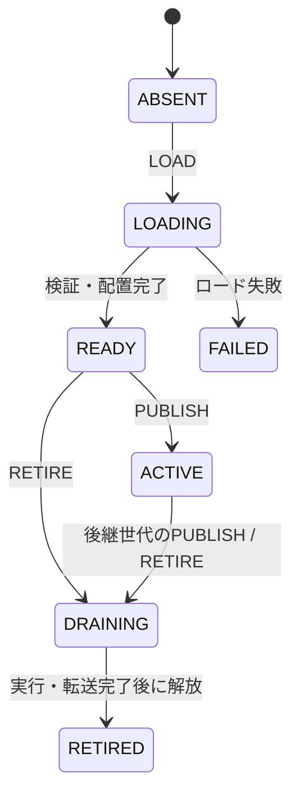

# Expert実行プロトコル草案

設計上の意味を先に定める。以下はwire formatや実装済みAPIではない。

## 識別子

- `expert_id`：モデルの名前空間とlayerを含めて一意にする。
- `generation`：不変の重みと演算記述を識別する。公開済み世代の内容を上書きしない。
- `request_id`：session内の実行要求を識別する。
- `buffer_handle`：sessionに属するバッファの参照。範囲、権限、有効期間を持つ。
- `target_id`：engine内のCPU／GPU実行先を識別する。

## 操作

| 操作 | 主な入力 | 成功時の意味 |
| --- | --- | --- |
| HELLO | protocol version、必要なcapability | sessionを確立し、engine ID、CPU／GPU実行先のリスト、通信経路の帯域を返す |
| LOAD | expert ID、世代、target ID、manifest URI、期待する内容ハッシュ | 指定先の容量を確認してロードを受理。実行可能とは限らない |
| STATUS | expert ID、世代 | 現在の状態と失敗理由を返す |
| PUBLISH | expert ID、新世代、期待する現在世代 | READYの世代を新規受付先に設定し、旧世代を排出開始 |
| INVOKE | request ID、expert ID、世代、tensor記述、入力・出力buffer handle | 受付または明示的な拒否を返す |
| COMPLETE | request ID、結果状態、出力記述 | 結果の可視化と転送が完了し、入力も再利用可能 |
| RETIRE | expert ID、世代 | 新規受付を停止し、受付済み処理の完了後に解放 |

メイン側がexpertの配置と入れ替えを指示する。PUBLISHはそのengine上の現在世代が期待値と一致した場合だけ成功する。初回公開は現在世代なしを明示する。

## 実行先と帯域の通知

`HELLO`は、同じengine内でCPUとGPUが混在できるように、実行先をリストで返す。

| 項目 | 内容 |
| --- | --- |
| `target_id`、`kind` | engine内の実行先IDと種別（`cpu` / `gpu`） |
| `max_memory_bytes` | expertの重みに割り当てられる上限。CPUはホストRAM、GPUはVRAMの予算 |
| `available_memory_bytes` | 通知時点の残容量。ロード時にengineが実際の残容量を確認する |
| `memory_bandwidth_bytes_per_sec` | 実行先が使うメモリの帯域 |
| `capabilities` | 対応演算、dtype、その他の実行上限 |

通信帯域は経路ごとの値として返し、`upi`と`roce_v2`を区別する。実行先のメモリ帯域は別項目とする。帯域には測定値か公称値かを付け、値が分からない場合は未報告とする。メモリ予算や通信経路を複数の実行先が共有する場合は、共通のリソースIDを返す。

## 状態

初期案ではINVOKEを受け付けるのはACTIVEの世代だけ。READYはロード済みだが未公開。RETIREはREADYにも適用できる。RETIREDになった世代識別子は再利用しない。

## hidden state配送

tensor記述はtoken数、hidden dimension、dtype、layout、byte lengthを持つ。engineは演算との整合性、バッファ境界、サイズ上限を検証する。初期案は連続配置のtensorに限定する。

受信側が貸し出すバッファとcreditの範囲内で送る。入力の転送完了・可視化を確認してから実行し、出力の転送完了・可視化を確認してからCOMPLETEを通知する。具体的なRDMA Read / Write / Sendとメモリ順序の規則は後続のtransport仕様で定義する。

INVOKEの受付応答だけでは、バッファを再利用できない。buffer handleを実アドレスやrkeyへどう対応させるか、session終了時にどう失効させるかもtransport仕様で定義する。

## エラーと再試行

少なくとも `NOT_READY`、`STALE_GENERATION`、`UNSUPPORTED_FORMAT`、`INVALID_BUFFER`、`NO_CAPACITY`、`BUSY`、`LOAD_FAILED` を区別する。

世代の不一致を別世代への自動フォールバックで処理しない。BUSYには再試行の目安を返せるようにする。

接続断では実行済みか不明になる可能性がある。初期PoCでは自動再送しない。切断したsessionの領域は、残存DMAと実行処理の停止を確認するまで再利用しない。再接続をまたぐ重複排除や結果照会は後続仕様とし、exactly-onceは保証しない。

## セキュリティ境界

初期PoCは信頼された隔離環境を対象にする。LOADのURIは許可済みのweight store配下に限定する。認証、認可、tenant間のメモリ分離、転送の保護は本運用前に定義する必要がある。
